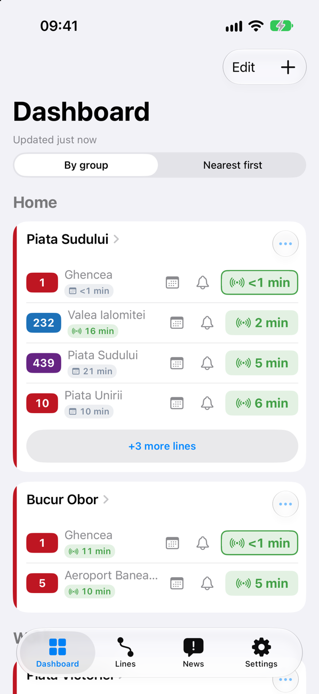
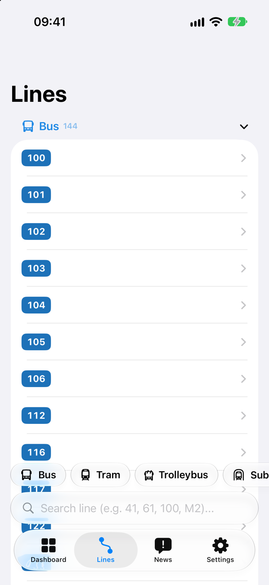
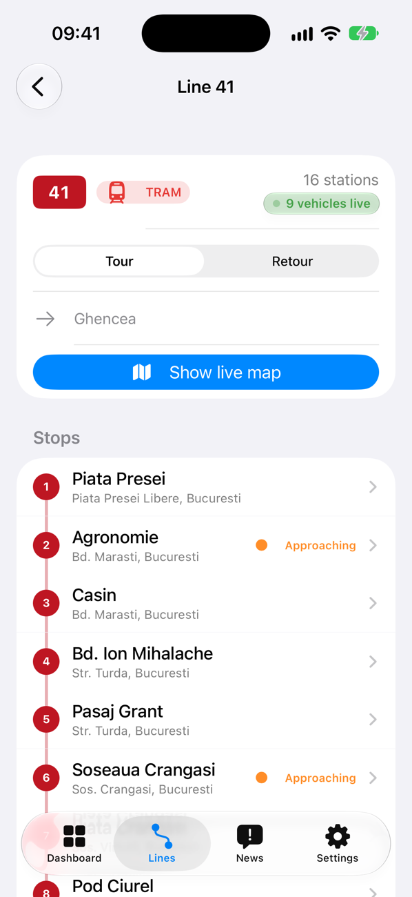
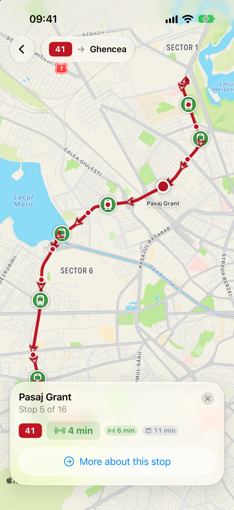
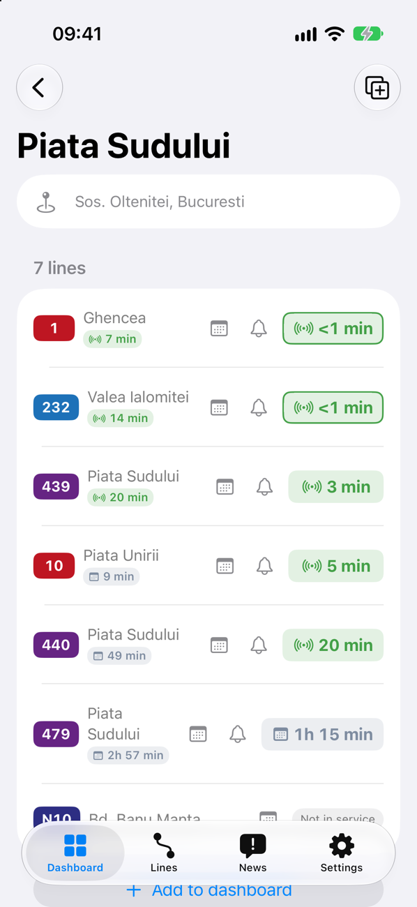
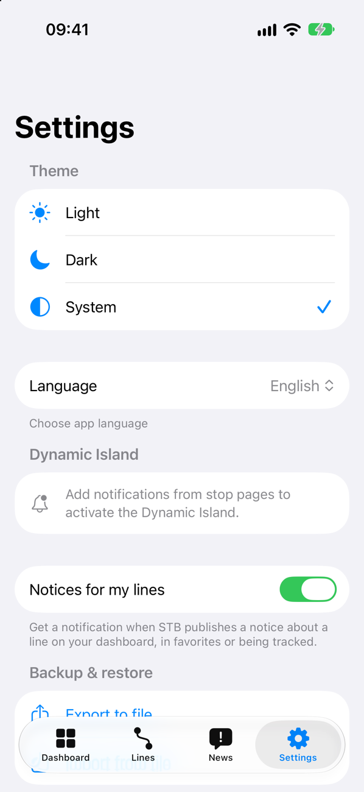
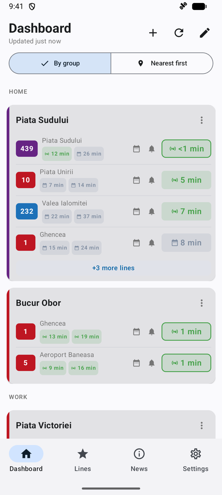
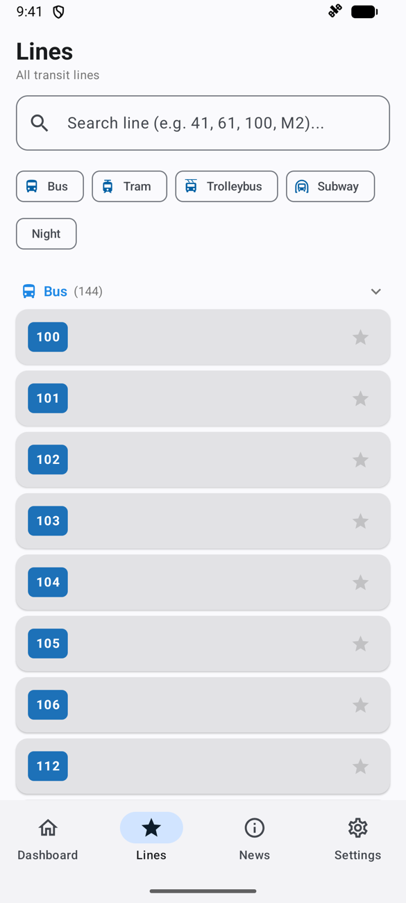
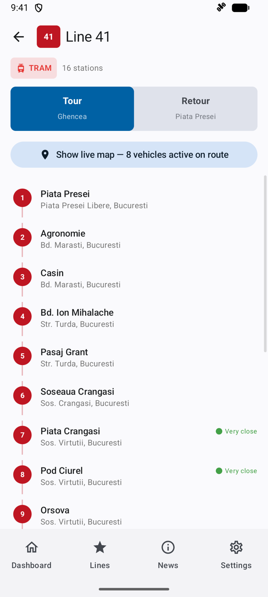
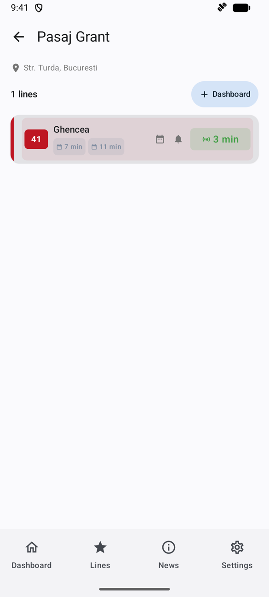

# InfoTB

**Live arrivals for Bucharest's buses, trams, trolleybuses and metro, built to be glanced at.**

InfoTB is a modern client for STB, Bucharest's public transport operator. Pin the stops you use every day to a dashboard, see when the next vehicle arrives (live GPS or timetable), and follow your ride in the Dynamic Island while your phone is in your pocket.

It's a native app on both platforms: **SwiftUI with Liquid Glass on iPhone**, **Material 3 with Jetpack Compose on Android**, sharing one Kotlin core.

---

## iPhone

| Dashboard | Lines | Line |
|:---:|:---:|:---:|
|  |  |  |

| Live map | Stop | Settings |
|:---:|:---:|:---:|
|  |  |  |

## Android

| Dashboard | Lines | Line | Stop |
|:---:|:---:|:---:|:---:|
|  |  |  |  |

---

## Features

- **Dashboard of your stops.** Live countdowns that keep ticking between refreshes, the next few departures for every line, and a warning when data goes stale.
- **Groups with active hours.** Put stops in groups like "Home" and "Work"; a group can show up expanded only during the hours you need it (say, 07:00–09:30).
- **Nearest first.** One tap orders the dashboard by distance from where you are.
- **Track an arrival.** Tap the bell next to a line and follow it in the **Dynamic Island** and on the Lock Screen (iPhone), or in an ongoing notification (Android), until it reaches your stop.
- **Every line, searchable.** Filter by bus, tram, trolleybus, metro or night lines, and star your favourites.
- **Live map.** See a line's route, its direction and every vehicle on it right now; tap a stop to see when the next one arrives there.
- **Timetables.** The full day's schedule for any line at any stop, scrolled to the current hour.
- **STB notices.** Service notices show up on the cards of the lines they affect, and you can be notified when a line you follow gets one.
- **Metro in its real colours.** M1 yellow, M2 blue, M3 red, M4 green, M5 orange.
- **Romanian and English**, light and dark mode, and backup/restore of your dashboard to a file.

## Get the app

- **Android:** download the APK from the [latest release](https://github.com/dev-andrei-v/infotb-modern-client/releases/latest) (Android 8.0+).
- **iPhone:** the release includes an unsigned IPA you can sideload with [iLoader](https://github.com/nab138/iloader) or Sideloadly (iOS 17+). See [Building & releasing](docs/building.md#ios-sideloading) for what works with which tool.

Want to build it yourself? Start with [docs/building.md](docs/building.md).

## Documentation

| Doc | What's in it |
|---|---|
| [Architecture](docs/architecture.md) | How the shared Kotlin core, the Compose app and the SwiftUI app fit together |
| [STB API](docs/stb-api.md) | The endpoints, authentication and protobuf format the app talks to |
| [Building & releasing](docs/building.md) | Building for Android, desktop and iOS; CI, releases and sideloading |

---

## About this project

> [!NOTE]
> **InfoTB is an independent project and is not affiliated with STB or Metrorex.** Arrival data comes from STB's public API.

InfoTB exists because public transport information is a public service, paid for by taxpayers, and riders deserve a client that is fast, clear and pleasant to use. The official app falls short of that, so this is a take on how it could be done.

**No hacking is involved.** InfoTB uses the same public API that STB's own website (info.stb.ro) uses, in the same way: it identifies itself, requests the same data, and doesn't bypass any access controls. We believe the details of this API should be openly documented for everyone, which is why they are written up in [docs/stb-api.md](docs/stb-api.md).
