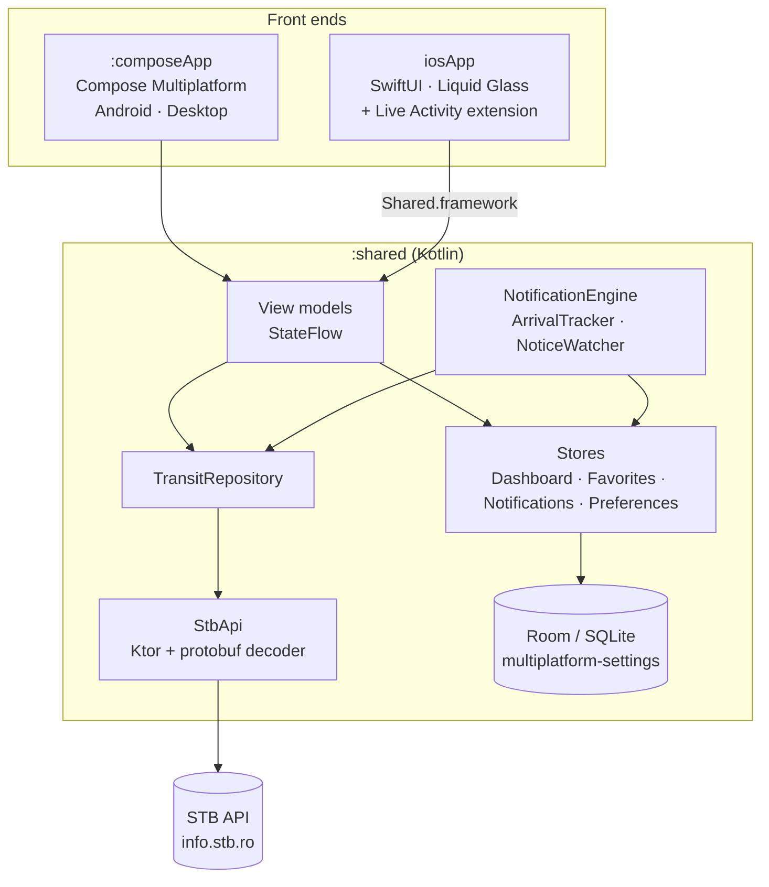

# Architecture

InfoTB is a Kotlin Multiplatform project with one shared core and two native front ends.



## Modules

| Module | What it is |
|---|---|
| `:shared` | All business logic: STB API client and protobuf decoding, Room database, stores, the five view models, live-tracking engine, i18n strings. Builds for Android, JVM desktop and iOS (as `Shared.framework`). |
| `:composeApp` | The Android and desktop app, written in Compose Multiplatform with Material 3. |
| `iosApp/` | The iPhone app, an Xcode project written in SwiftUI. It links `Shared.framework` and adds the Live Activity extension for the Dynamic Island. |

## The shared core

- **View models** (`shared/.../ui/viewmodel`): `DashboardViewModel`, `LinesViewModel`, `LineDetailViewModel`, `StopDetailViewModel`, `AnnouncementsViewModel`. They are AndroidX `ViewModel`s exposing `StateFlow`s and are used unchanged by both front ends.
- **`TransitRepository`** wraps `StbApi` and de-duplicates stop requests: callers asking for the same stop within a few seconds share one network call, since the dashboard, stop screen and tracking engine all poll stops.
- **Stores** keep user state: dashboard cards and groups, favourite lines and tracking subscriptions live in Room; theme, language and small flags live in multiplatform-settings.
- **`NotificationEngine`** polls tracked arrivals every 30 seconds, works out where the approaching vehicle is along the route, and drives the platform's live surface (Dynamic Island / ongoing notification). **`ArrivalTracker`** is the single entry point both apps call when the user taps the bell.
- **`lineColor`** swaps STB's uniform metro colour for the Metrorex colours.

Platform differences are kept to a few `expect`/`actual` pieces:

| Concern | Android | Desktop | iOS |
|---|---|---|---|
| HTTP engine | OkHttp | java.net.http | Darwin (URLSession) |
| Database file | `Context.getDatabasePath` | `~/.stb/stb.db` | app Documents |
| Settings | SharedPreferences | java.util.prefs | NSUserDefaults |
| Live tracking | foreground service + notification | console log only | Live Activity via `NSNotificationCenter` |
| Location | `LocationManager` | not supported | CoreLocation |

## How SwiftUI talks to Kotlin

The iOS app never re-implements logic; it observes the shared view models.

- `IosServices` (Kotlin, `iosMain`) exposes the Koin singletons and creates view models.
- `KotlinScope` (Swift, `Bridge/KotlinBridge.swift`) subscribes to Kotlin `Flow`s through the `watch(flow:onEach:)` helper and owns view models through `ViewModelOwner`, so `onCleared()` runs when a screen goes away.
- Each screen has a small `@Observable` Swift model that copies flow values into typed properties, which SwiftUI renders.
- Kotlin functions called from Swift that can fail are marked `@Throws` (or return `null`), because an unhandled Kotlin exception would crash the app.

Live tracking crosses the language boundary through `NSNotificationCenter`: Kotlin's `IosNotifier` posts start/update/stop messages, and `LiveActivityManager.swift` turns them into ActivityKit updates.

## Where things are

| Path | Contents |
|---|---|
| `shared/src/commonMain/kotlin/ro/infotb/modern/data` | API client, protobuf decoder, Room entities and DAOs, repository, stores |
| `shared/src/commonMain/kotlin/ro/infotb/modern/ui/viewmodel` | Shared view models |
| `shared/src/commonMain/kotlin/ro/infotb/modern/notification` | Tracking engine, notice watcher, arrival tracker |
| `shared/src/commonMain/kotlin/ro/infotb/modern/util` | Strings (`I18n.kt`), constants, polyline, vehicle proximity, line colours |
| `shared/src/iosMain/kotlin/ro/infotb/modern/ios` | Swift entry points and bridge helpers |
| `composeApp/src/commonMain/kotlin/ro/infotb/modern/ui` | Compose screens, components, theme, navigation |
| `iosApp/iosApp/{App,Bridge,Components,Screens}` | SwiftUI app |
| `iosApp/InfoTBLiveActivity` | Dynamic Island / Lock Screen widget |
| `shared/schemas` | Exported Room schemas |

## Database

```
stb.db
├── widgets                    (id, stopId, stopName, size, groupName, visibleLines, hidden, sortOrder)
├── dashboard_groups           (name, sortOrder, hidden, activeFrom, activeTo)
├── favorites                  (lineId)
└── notification_subscriptions (id, stopId, stopName, lineId, lineName, lineColor, direction, mode, thresholdMinutes, enabled)
```

Lines, arrivals and notices are not stored; they are always fetched live (stop info is cached in memory for a few seconds).

## Strings

All user-facing text goes through `t(key, locale)` in `I18n.kt`, in Romanian and English. Swift calls the same function through `tr("key")`, so both apps share one set of strings.
